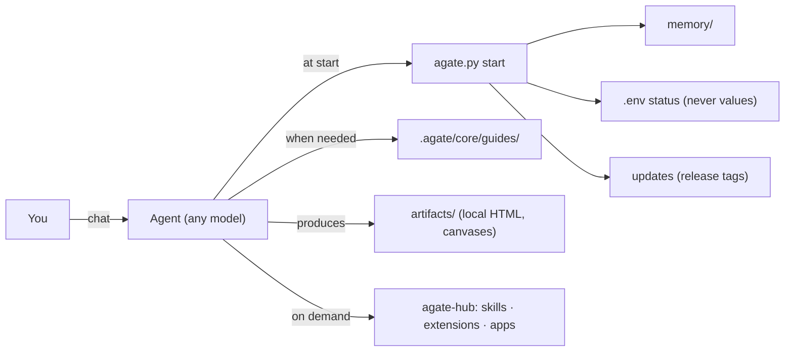

<p align="center">
  
</p>

<h1 align="center">Agate</h1>

<p align="center">
  <b>Your AI projects, in git.</b> Like Claude Projects, but in a repo, with any model and any harness.<br>
  What gets discussed, decided and produced stays with the team.
</p>

<p align="center">
  
  
  
  
</p>

---

## Why
- **Projects that remember, shared.** Memory, documents and artifacts live in the repo, not in someone's account.
- **Light by design.** About 1.35K tokens are loaded on every message; everything else is read only when needed.
- **Checks in code, not in prompts.** One command (`agate.py`) handles start-up, memory, keys, connectors and updates,
  and prints only what needs attention.
- **On demand.** Skills, extensions and apps come from the [Agate hub](https://github.com/agate-project/agate-hub)
  only when a project needs them.
- **Your language.** Instructions are in English for the model; it replies in each person's own language.

## Quick start
1. Click **Use this template** above (or `gh repo create <owner>/<name> --template agate-project/agate --private --clone`).
2. Open the folder in your harness (Orca, Claude Code…).
3. Say **hello**. The first `start` sets the project up (folders, git hooks) and the agent fills in what the project is
   about as you talk. Want a guided start? Ask for `quick-start`.

## How it fits together


## What's inside
| Path | What it is |
|---|---|
| `AGENTS.md` | Short project instructions, read by any model (`CLAUDE.md` imports them). |
| `memory/` | What the agent keeps in mind. `shared/` is committed, `local/` stays on your machine. |
| `documents/` | Long material, read when needed. |
| `artifacts/` | What gets produced: local HTML pages and canvases, by month. Commentable and live with `agate.py serve`. |
| `archive/` | Archived items under their original path; only the index is committed. |
| `.agate/` | `agate.py` (the single command). `core/` is Agate itself (replaced by updates); the rest is this project's settings. |
| `.agents/skills/` | Skills: `canvas` and `web-research` ship with the base; the rest is installed on demand. |

## Everyday commands
The agent runs these for you; they're here so you know what exists.
```
python3 .agate/agate.py start              # start of a conversation (only prints what needs attention)
python3 .agate/agate.py memory add <name>  # save something worth remembering
python3 .agate/agate.py env set <NAME>     # set an API key (hidden input; never in the chat)
python3 .agate/agate.py serve              # view artifacts/canvases with live updates and comments
python3 .agate/agate.py tokens             # how much context the project takes
python3 .agate/agate.py check | update     # updates (only from release tags; scripts ask first)
python3 .agate/agate.py add <name>         # a skill, extension (product…) or app:<name> from the hub
```

## Security
- API keys are never printed or read by the agent; a hook blocks keys pasted in the chat before they reach the model.
- Packages come from release tags; anything with scripts asks first.
- Previews of local pages only through private channels (Orca's browser, Tailscale allowlist, SSH), never public tunnels.

## License
[Apache 2.0](LICENSE). See [`CHANGELOG.md`](CHANGELOG.md) for versions.
